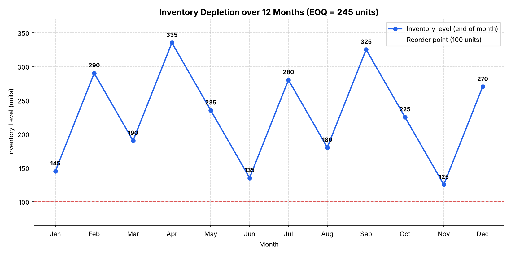

# 📦 Inventory Management & Optimization (EOQ)

**AI in Operations, Session IV Lab Exercise.** Retail inventory optimization using the Economic Order Quantity (EOQ) model, delivered as an interactive Streamlit dashboard.

$$EOQ = \sqrt{\frac{2DS}{H}}$$

- **D**: annual demand (units per year)
- **S**: setup or ordering cost (per purchase order)
- **H**: holding or carrying cost (per unit, per year)

## Features
- EOQ calculated from demand, ordering cost and holding cost
- Inventory levels simulated monthly over 12 months (line plot of inventory depletion)
- Each point labelled with the remaining units; gridlines and axis labels for readability
- Reorder point, order markers, optional lead time and safety stock
- Seasonality and random-demand stress test of the EOQ policy
- Cost trade-off curve (ordering vs holding vs total cost) with a what-if comparison
- Downloadable monthly simulation table (CSV)

## Files
| File | Purpose |
|---|---|
| `app.py` | Streamlit dashboard |
| `eoq_model.py` | EOQ, cost and monthly simulation logic |
| `eoq_lab.py` | Static matplotlib version of the lab exercise |
| `eoq_inventory_plot.png` | Output of `eoq_lab.py` |

## Run locally
```bash
pip install -r requirements.txt
streamlit run app.py      # dashboard
python eoq_lab.py         # static lab plot
```

## Default example
D = 1,200 units/yr, S = AED 50, H = AED 2 → **EOQ ≈ 245 units**, about 4.9 orders/year, total annual cost ≈ **AED 489.90**. At the EOQ, ordering cost equals holding cost (AED 244.95 each).


